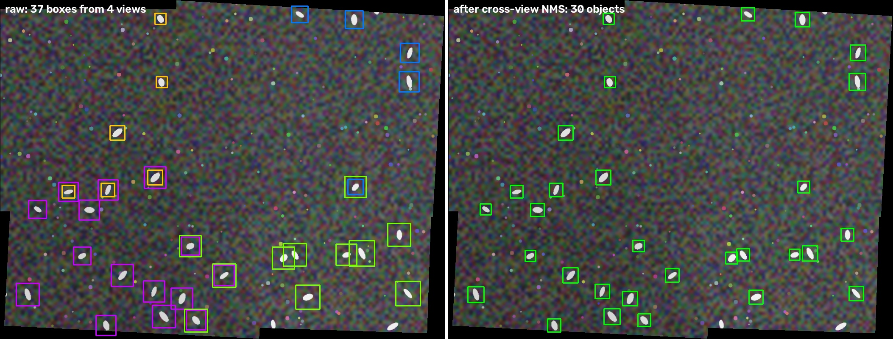

# multiview-stitching

[](https://github.com/LinRungChi/multiview-stitching/actions)

Register several overlapping camera views into one frame, render a seamless mosaic, and merge per-view detections so that each object is counted once.

This is a clean, standalone re-implementation of the multi-view pipeline I built for an 8-camera full-tank fish fry counting system ([ICASI 2025](https://doi.org/10.1049/icp.2025.2563)). This version runs on a synthetic planar scene with known ground truth; swap in your own images and detector outputs.



*Left: raw detections from four cameras, coloured by camera; objects in overlap regions get two boxes. Right: after projecting every box into the shared frame and running cross-view NMS.*

## What it does

| Step | Module | Method |
|---|---|---|
| Feature matching | `registration.match_features` | SIFT (or ORB) + Lowe's ratio test |
| Pairwise alignment | `registration.estimate_homography` | RANSAC homography, with inlier count and reprojection RMSE |
| Multi-view frame | `mosaic.build_mosaic` | chains pairwise homographies into one reference frame along a user-defined pair graph |
| Rendering | `Mosaic.render` | distance-transform feather blending to hide seams and per-camera exposure differences |
| Counting | `dedup.deduplicate` | projects each detection into the mosaic; greedy NMS across *different* views only |

The design assumption is a roughly planar scene (a tank floor, a conveyor, a field seen from above), where a homography per camera pair is the right model.

## Install

```bash
pip install -e .[dev]
pytest -q          # 3 tests, ~2 s
python examples/demo.py --out docs
```

## Usage

```python
import cv2
from multiview_stitching import build_mosaic, Detection, deduplicate

views = [cv2.imread(f"cam{i}.jpg") for i in range(4)]

# which view is registered onto which; the reference (view 0) must be reachable
m = build_mosaic(views, order=[(1, 0), (2, 0), (3, 1)])
for s in m.pair_stats:
    print(s.n_inliers, "/", s.n_matches, "inliers, RMSE", round(s.reproj_rmse, 2), "px")

mosaic = m.render(views)              # H x W x 3 uint8
cv2.imwrite("mosaic.jpg", mosaic)

# detections from any per-view detector, in each view's own pixel coordinates
dets = [Detection(view=0, box=(x1, y1, x2, y2), score=0.9), ...]
unique = deduplicate(m, dets, iou_thresh=0.3)
print(len(dets), "raw ->", len(unique), "objects")
```

`m.project_points(i, pts)` maps any pixel coordinates from view `i` into the mosaic, so tracks, masks or keypoints can be moved into the shared frame the same way.

## Results on the synthetic scene

Four 640×480 views of a 1400×900 textured scene, 35 % overlap, per-camera rotation ±4°, scale ±5 %, mild perspective, and brightness differences (`examples/demo.py --seed 3`):

```
pair 0: 81/85 inliers, reproj RMSE 0.17 px
pair 1: 65/76 inliers, reproj RMSE 0.14 px
pair 2: 67/85 inliers, reproj RMSE 0.12 px
raw detections across views: 37  ->  after de-duplication: 30  (objects fully visible in >=1 view: 30)
```

The tests check the estimated homographies against the ground-truth ones (corner error < 4 px after chaining three pairs) and that de-duplication recovers the true number of visible objects.

## Where this came from

In the fry-counting system the same four steps ran on eight cameras over a live tank: camera placement was planned from each camera's field of view so neighbours overlapped enough for matching, LoFTR replaced SIFT for the low-texture water surface, and YOLOv8 supplied the detections. The de-duplication rule (merge only across views, never within one) is what made whole-tank counts consistent with manual sampling.

## References

- D. G. Lowe. *Distinctive Image Features from Scale-Invariant Keypoints.* IJCV 60(2), 2004. (SIFT and the ratio test)
- E. Rublee, V. Rabaud, K. Konolige and G. Bradski. *ORB: An efficient alternative to SIFT or SURF.* ICCV, 2011.
- M. A. Fischler and R. C. Bolles. *Random Sample Consensus.* Communications of the ACM 24(6), 1981.
- J. Sun, Z. Shen, Y. Wang, H. Bao and X. Zhou. *LoFTR: Detector-Free Local Feature Matching with Transformers.* CVPR, 2021. (used in the fry-counting system, not in this repository)
- R.-C. Lin and P.-J. Chiang. *A Low-Cost Multi-Camera System for Full-Tank Fish Fry Counting in Aquaculture.* ICASI 2025, pp. 332–337. [DOI](https://doi.org/10.1049/icp.2025.2563)

Feature matching and homography estimation use [OpenCV](https://opencv.org/).

## License

MIT
